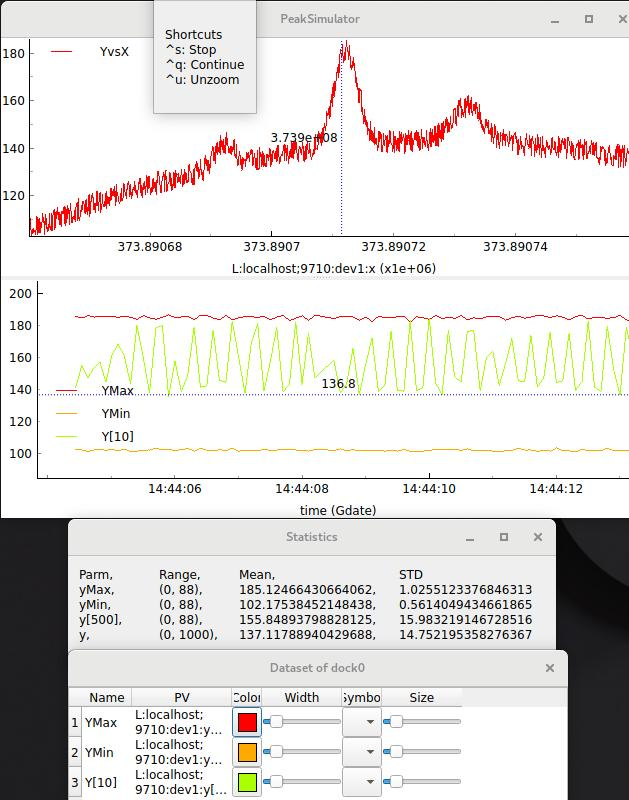

# pvplot

`pvplot` is a dynamic plotting application for control-system data. It supports EPICS PVAccess (PVA), EPICS Channel Access (CA), LiteServer data objects, and ADO parameters.



## Installation

Create and activate a virtual environment, then install the package:

```bash
python -m venv .venv
source .venv/bin/activate
python -m pip install -e .
```

Run `pvplot --help` to display the command-line options.

## Basic usage

```bash
python -m pvplot -a 'E:testAPD:scope1:' 'Waveform_RBV[1:500]'
python -m pvplot -aV:image:0: 'oneRowMean oneRowStd oneRowPeak2Peak'
python -m pvplot -aV:image:0: oneRow[90:120]
python -m pvplot -a 'L:localhost:dev1:' 'temp1 temp2'
```

Correlation plot — plot the parameter after the comma against the parameter before the comma:

```bash
python -m pvplot -a 'L:localhost;9710:dev1:' 'x,y'
```

Array data can be sliced using `name[start:end]`, for example `Waveform_RBV[1:500]`.

## Namespaces

Add a namespace prefix to parameter names to select an access method:

- `E:` — EPICS Channel Access
- `V:` — EPICS PVAccess
- `L:` — LiteServer, for example `L:localhost:dev1:`
- `A:` — ADO

## Command-line options

- `-a, --prefix` — Prefix applied to parameter names.
- `-c, --configDir` — Directory containing a configuration module.
- `-f, --file` — Configuration module name.
- `-l, --limit` — Maximum number of points retained per dataset.
- `-s, --sleepTime` — Update interval in seconds.
- `-v, --verbose` — Show more debug messages; use `-vv` for even more.
- `-x, --xscale` — LiteServer parameter providing dynamic X-axis scaling.
- `-X, --xrange` — Fixed X-axis range, for example `-X 10:20`.
- `-y, --yscale` — Parameter providing dynamic Y-axis scaling.
- `-Y, --yrange` — Fixed Y-axis range, for example `-Y 1000:4095`.
- `-z, --zoomin` — Scale the application window.
- `-#, --dock` — Assign parameters to named docks.

## Configuration file

Use `-c` and `-f` to load a Python configuration module:

```bash
python -m pvplot -c config -f peakSimulator_pvp
```

The configuration module may define `DOCKS`, `POINTS`, `TITLE`, `XLABEL`, and `YLABEL`.

## Plot controls

- Right-click a plot and select **Datasets Options** to enable/disable curves or change their color, width, and symbols.
- Use **Mean, sigma** to show dataset statistics.
- Use **Y Projection** to show a histogram of the visible Y range.
- Use **UnZoom** to restore the previous view range.
- Press `Ctrl+H` for help, `Ctrl+M` for statistics, `Ctrl+S` to stop/resume updates, or `Ctrl+U` to unzoom.

## Examples

- Two docks with an array plot and a strip chart:
  ```bash
  python -m pvplot -c /operations/app_store/pvplot -f peakSimulator_pvp
  ```
- Sliced EPICS Channel Access waveform:
  ```bash
  python -m pvplot -s 0.01 -a 'E:testAPD:scope1:' 'Waveform_RBV[1:500]'
  ```
- EPICS PVAccess waveform for `python -m epicsdev.imagegen -r30`:
  ```bash
  python -m pvplot -aV:image:0: -#0'oneRow' -#1'oneRowMean oneRowStd oneRowPeak2Peak'
  ```
- LiteServer correlation plot:
  ```bash
  python -m pvplot -s 0.01 -a 'L:localhost;9710:dev1:' 'x,y'
  ```
- LabJack U3-HV analog inputs served by LiteServer:
  ```bash
  python -m pvplot -a 'L:localhost:dev1:' 'tempU3 ADC_HV[0] ADC_HV[1] ADC_HV[2] ADC_HV[3] ADC_LV'
  ```
